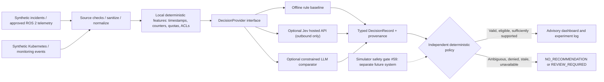

# Architecture — Jev advisory decisions for cloud–edge robotics

> **Design only.** No service, ROS 2 adapter, Jev provider, Kubernetes deployment, or safety gate is implemented by this document. Related: [#73](https://github.com/MSKazemi/Vagrant-Kubernetes-ROS2-Deployment/issues/73), [#55](https://github.com/MSKazemi/Vagrant-Kubernetes-ROS2-Deployment/issues/55), [#59](https://github.com/MSKazemi/Vagrant-Kubernetes-ROS2-Deployment/issues/59), [#60](https://github.com/MSKazemi/Vagrant-Kubernetes-ROS2-Deployment/issues/60).

## 1. Purpose and trust boundaries

Compare deterministic rules, Jev typed decisions and optionally constrained-output LLM classification for **non-time-critical, read-only** ROS 2/Kubernetes supervisory tasks. Keep the robotics action system entirely outside this initial experiment.

**Boundaries:**
- **Input zone:** structured, licensed **synthetic** incident payloads first. Treat logs, user messages and retrieved documentation as untrusted data, including any embedded instructions.
- **Normalization zone:** reject malformed, oversized, stale or unauthorized inputs; redact before an opt-in hosted request. Distinguish `event_time` from `observed_at`. Keep timestamp comparison, numerical thresholds and sequence checks in ordinary code.
- **Inference zone:** Jev is one `DecisionProvider` implementation, not the controller. Pin provider, question/criteria revision, model and SDK/API version for an experiment. Never treat provider confidence as authorization.
- **Policy zone:** validates schema and finite probabilities, unknown/abstention behavior, eligibility, temporal freshness, explicit scopes and review requirements. No output path here may execute arbitrary kubectl, shell, service calls or ROS actuator topics.
- **Evidence zone:** only sanitized metadata and permitted outputs; immutable experiment IDs and hashes, explicit synthetic-data markers, failed requests counted.

## 2. Proposed interface contracts

Keep the provider boundary stable so researchers can compare methods on identical inputs.

| Proposed type | Required fields | Reason |
| --- | --- | --- |
| `IncidentV0` | `schema_version`, `incident_id`, `synthetic`, `observed_at_utc`, `source_kind`, `events`, `context` | Traceable, bounded evidence |
| `DecisionRequestV0` | `question_set_version`, `incident_ref`, `candidate_classes`, `provider`, `deadline_ms` | Identical comparisons |
| `DecisionRecordV0` | `provider`, `model_revision`, `question_hash`, `selected_class`, `probabilities|null`, `confidence|null`, `status`, `reason_codes`, `latency_ms|null` | Explicit uncertainty and measurement |
| `PolicyVerdictV0` | `eligible`, `reason_codes`, `review_required` | Enforcement independent of model |

These are **proposed** contracts, not yet formal JSON Schemas. Issue #74 owns their formalization, tests and implementation. Existing issue #55 owns the robotics observation/action contract; **do not replace** it with this incident-triage format.

Use states **ADVISORY**, **REVIEW_REQUIRED**, **NO_RECOMMENDATION**. A request may succeed at the HTTP layer yet become `REVIEW_REQUIRED` because the evidence is contradictory or model distribution is inconclusive. Missing key or timeout yields `NO_RECOMMENDATION`, not a silent success.

### What an independent policy checks

1. Input source allowlist, size, redaction and age. If any required element fails, do **not** invoke a hosted model.
2. Candidate set limited to explicitly enumerated classes, including `unknown`. If the response is not exactly an allowed class, reject it.
3. Response JSON schema/finite probability ranges and approximate sum tolerance; do not synthesize missing probabilities or automatically trust `confidence`.
4. Separately calibrated abstention threshold / maximum acceptable error selected using development data, **never the test set**. Record chosen threshold/version. A threshold is for read-only triage only, not physical safety.
5. Optional human review on ambiguous or out-of-distribution incident descriptions. Require independent authorization for any later action-producing workflow.

## 3. Provider mapping: Jev, rules and LLMs

| Provider | Input | Output | Failure/uncertainty |
| --- | --- | --- | --- |
| Offline rules | validated synthetic incident | class or `unknown`, reasons | no model probabilities; no invented confidence |
| Jev | minimized state + `Choice`/`Noul` questions | typed distribution / binary probability | no key, 4xx/429/5xx, timeout, malformed answer -> NO_RECOMMENDATION |
| Optional LLM | same permitted incident data + fixed JSON schema | validated classification only | parsing/validation failure -> NO_RECOMMENDATION |

The [official Jev HTTP API](https://docs.typesafe.ai/api/system-one) accepts `POST https://api.typesafe.ai/v1/systemone` with `model`, `state` and a map of named `questions`. `Choice` answers contain the selected option, `probabilities` and `confidence`; `Noul` answers contain a yes probability but no separate confidence. `Score` uses ordered rubric levels and is **not** appropriate for exact arithmetic. The official API also documents an image-specific `Box` primitive; visual localization is explicitly **out of scope** for this text/synthetic incident triage experiment.

A request with `jev-latest` is acceptable as **exploration**; use an available **pinned exact model** for measured comparisons, record the actual response model ID, and verify model availability with the provider. See [illustrative request](examples/jev-choice-request.json). The repo does not ship a usable Jev client yet.

## 4. Cloud/edge placement: service locality vs decision locality

- **Edge:** source ROS 2 nodes, perception and all time-sensitive control. Hard bounds and safe fallback remain local.
- **Kubernetes lab:** optional read-only event aggregation, diagnostics, benchmark recording and hosted Jev API client.
- **External provider:** a separately authorized, outbound call with strict quotas and minimized redacted state. Provider roundtrip is **not** acceptable as a motor control dependency.

Network disconnection, overload, stale robot state, cloud budget exhaustion or API unavailability must never produce robot commands. Later simulator experiments must go through independent typed contract #55 and fail-closed simulated action gate #59.

### Deployment expectations (proposal, not YAML here)

- Least-privilege service account, no ambient kubeconfig, no cluster-admin, no Kubernetes Secret mounted into an untrusted worker.
- Egress only where justified, timeouts, bounded in-flight work and retries (especially rate limits); no inbound public service necessary for a first PoC.
- Local default with no provider key/paid dependency. Live calls **opt-in** only and never part of default CI.
- Separate synthetic experiment namespace; permit human cancellation and deterministic rollback.
- Resource requests/limits and explicit billing guard before any hosted load tests.

## 5. Failure modes and observable outcomes

| Condition | Policy behavior | Experiment evidence |
| --- | --- | --- |
| No key or consent | Offline-only / no hosted call | provider_not_attempted |
| Contradictory DDS/QoS events | Review / unknown | ambiguous_input |
| Prompt-injection text within log | Ignore directives; classify only | adversarial_fixture |
| Provider 401/422 | No recommendation; surface configuration error | http_status, retry_count=0 |
| Provider 429/5xx or timeout | Bounded retry where justified; no recommendation when exhausted | attempt_count, total_elapsed_ms |
| Selected class not in criteria | Reject response | schema_failure |
| Numeric threshold/TTL violation | Reject in deterministic code, irrespective of Jev score | ineligible_reason |
| Apparent high model confidence on OOD input | Require validation/review | confidence_not_authority |

## 6. Research instrumentation

Match [benchmark protocol](BENCHMARK-PROTOCOL.md) and issue #60: host timestamp and monotonic duration, provider/model ID, question/criteria hash, variant and option order, dataset family/split/seed, input bytes, token usage when available, error codes, wall-clock request latency, rule processing time, status and decision outcome. Report provider error rates **including** outages; never publish p95 of only successful responses as the complete experience.

## 7. Security and reproducibility

Follow [Safety and privacy](SAFETY-PRIVACY.md), root [SAFETY.md](../../../SAFETY.md), [AGENTS.md](../../../AGENTS.md), and [official Jev limitations](https://docs.typesafe.ai/model-jaggedness/jev-1.13). This architecture is intentionally not framed as a certified robot controller or a validated multi-node cluster feature.
