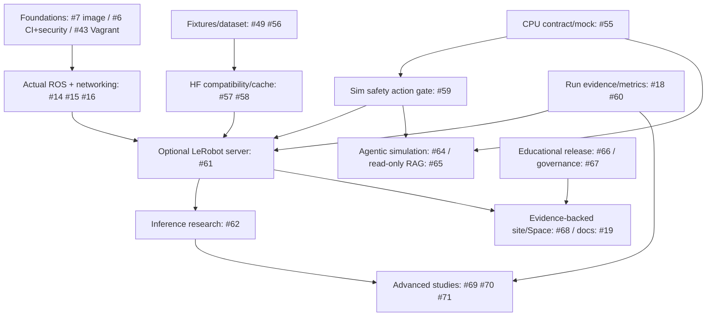

# 12-month delivery, research and adoption roadmap (late 2026–2027)

> **Planning targets, not delivery promises.** The original ROS 2/Kubernetes modernization roadmap [docs/ROADMAP-2026.md](../ROADMAP-2026.md) remains authoritative for the prerequisite cluster. New AI/LLM features are a *gated* research track. An open PR [#50](https://github.com/MSKazemi/Vagrant-Kubernetes-ROS2-Deployment/pull/50) contains a complementary industry/academia strategy, not yet merged.

## North star and product choices

Working project identity: **Cloud Robotics + AI/LLM Lab** (RobotOps experimental track). Core value: **hardware-free reproducible robotics-AI experiments**, not production robot control.

**Choose one demonstration first:** a deterministic, licensed *synthetic* image + robot-state + action + task episode. First prove contract/validator/offline data readback; after platform gates, prove actual ROS messaging and optionally a supported LeRobot policy checkpoint. Avoid trying to ship navigation, SLAM, motion planning, fleets, LLMs, RL and VLA in the same first release.

## Dependency map

CPU-only schema/fixture and governance work **can start in parallel** with the foundational cluster upgrade; any cross-worker/policy-service claim cannot pass until the corresponding gate is satisfied. The arrows are conceptual dependencies, not a task execution plan.

## Priority 0 — fix core evidence and security (existing work)

| Workstream | Existing issue | Exit evidence |
| --- | --- | --- |
| Version and image lifecycle | [#7](https://github.com/MSKazemi/Vagrant-Kubernetes-ROS2-Deployment/issues/7) | Supported pinned distribution and image, no legacy overclaim |
| Self-starting ROS app and two-worker proof | [#14](https://github.com/MSKazemi/Vagrant-Kubernetes-ROS2-Deployment/issues/14) | Listener output and actual worker placement with negative tests |
| Supported networking/explicit DDS discovery | [#15](https://github.com/MSKazemi/Vagrant-Kubernetes-ROS2-Deployment/issues/15) | Two-worker topology + restart reconnection reproducibility |
| Low-resource fresh cluster profile | [#16](https://github.com/MSKazemi/Vagrant-Kubernetes-ROS2-Deployment/issues/16) | One verified setup/test/cleanup on documented host |
| CI, privilege, dependency pins | [#6](https://github.com/MSKazemi/Vagrant-Kubernetes-ROS2-Deployment/issues/6), [#43](https://github.com/MSKazemi/Vagrant-Kubernetes-ROS2-Deployment/issues/43) | Checks and sensitive join tokens/credentials no longer in checkout |
| Distinguish true benchmarks from historic artifacts | [#18](https://github.com/MSKazemi/Vagrant-Kubernetes-ROS2-Deployment/issues/18), [#45](https://github.com/MSKazemi/Vagrant-Kubernetes-ROS2-Deployment/issues/45), [#46](https://github.com/MSKazemi/Vagrant-Kubernetes-ROS2-Deployment/issues/46) | Corrected scripts, complete raw data and reproducible historical plots |

**Until these gates are satisfied:** the root README and project homepage must not say "modern multi-node cloud robotics platform deployed and tested" or "real-time robotic AI".

## Work packages and priorities

| Track | Priority | Specific owned issue | Deliverable/evidence |
| --- | --- | --- | --- |
| Hardware-free AI integration | P1 | [#55](https://github.com/MSKazemi/Vagrant-Kubernetes-ROS2-Deployment/issues/55) | Typed v1 ROS/simulator observation/action, mock policy, negative tests |
| Robotics data science | P1 | [#56](https://github.com/MSKazemi/Vagrant-Kubernetes-ROS2-Deployment/issues/56) | Licensed aligned LeRobotDataset v3 fixture with readback |
| Upstream bridge audit | P1 | [#57](https://github.com/MSKazemi/Vagrant-Kubernetes-ROS2-Deployment/issues/57) | Compatible plugin/embodiment/version matrix, no needless reimplementation |
| Reproducible ML lifecycle | P1 | [#58](https://github.com/MSKazemi/Vagrant-Kubernetes-ROS2-Deployment/issues/58) | Hub revision/hash, offline cache, mismatch rejection |
| Simulator action security | P1 | [#59](https://github.com/MSKazemi/Vagrant-Kubernetes-ROS2-Deployment/issues/59) | Deterministic reject/hold with recorded fault cases |
| Experiment evidence | P1 | [#60](https://github.com/MSKazemi/Vagrant-Kubernetes-ROS2-Deployment/issues/60) | Run manifest schema, traces, offline plot regen |
| Inference on Kubernetes | P2 | [#61](https://github.com/MSKazemi/Vagrant-Kubernetes-ROS2-Deployment/issues/61) | Protected pinned upstream LeRobot service and verified simulated client |
| Placement PhD study | P2 | [#62](https://github.com/MSKazemi/Vagrant-Kubernetes-ROS2-Deployment/issues/62) | Local vs remote action-age failure-inclusive trials |
| Agentic high-level tasks | P2 | [#64](https://github.com/MSKazemi/Vagrant-Kubernetes-ROS2-Deployment/issues/64) | Allowlisted typed skills, approval and injection tests |
| Read-only RAG | P2 | [#65](https://github.com/MSKazemi/Vagrant-Kubernetes-ROS2-Deployment/issues/65) | Source-grounded troubleshooting evaluation |
| University curriculum | P2 | [#66](https://github.com/MSKazemi/Vagrant-Kubernetes-ROS2-Deployment/issues/66) | Six graded labs + TA validation and independent reproduction |
| AI ethics/governance | P1 cross-cutting | [#67](https://github.com/MSKazemi/Vagrant-Kubernetes-ROS2-Deployment/issues/67) | Data/model cards, risk register, explicit ethics review gates |
| Showcase and documentation | P2 | [#68](https://github.com/MSKazemi/Vagrant-Kubernetes-ROS2-Deployment/issues/68), [#19](https://github.com/MSKazemi/Vagrant-Kubernetes-ROS2-Deployment/issues/19) | Accurate docs, read-only public result explorer |
| Multi-robot fairness | P3 | [#69](https://github.com/MSKazemi/Vagrant-Kubernetes-ROS2-Deployment/issues/69) | Resource contention and isolation experiment |
| Energy/cost study | P3 | [#70](https://github.com/MSKazemi/Vagrant-Kubernetes-ROS2-Deployment/issues/70) | Metered energy and task cost with uncertainty |
| Embodied AI simulation gap | P3 | [#71](https://github.com/MSKazemi/Vagrant-Kubernetes-ROS2-Deployment/issues/71) | Exact model/embodiment compatibility and controlled domain shifts |

Existing [#48](https://github.com/MSKazemi/Vagrant-Kubernetes-ROS2-Deployment/issues/48) owns DDS vs ROS-specific Zenoh under impairment. Existing [#49](https://github.com/MSKazemi/Vagrant-Kubernetes-ROS2-Deployment/issues/49) owns realistic hardware-free ROS sensor workload. Do not duplicate these in a new package.

## Milestones (relative to an approved implementation start, not fixed deadlines)

### Phase 0 — weeks 1–4: evidence and design
- Confirm baseline versions, support matrix and safety; prioritize #14/#15/#16, #6/#43.
- Decide synthetic camera/state/action/task fixture and data license, mock policy contract, data/processor semantics and gate tests.
- Freeze exact proposed LeRobot API release for evaluation and compare existing ROS bridge options.
- Add schema test and public documentation before introducing model download complexity.
- **Exit:** documented compatibility/risk decision; CPU-only fixture/schema CI tests **actually pass** and are linked.

### Phase 1 — weeks 5–8: CPU-only flagship
- Implement #55 and #59 with intentional failure tests; complete tiny #56 offline readback and #58 manifest/cache controls.
- Build #60 run schema with clear UTC/monotonic clock semantics, failure record and offline sample plot.
- Obtain an independent second-person reproduction on a clean documented laptop; retain resource measurements.
- **Exit:** measurable, honest E0/E1 lab and negative cases, **no mandatory GPU/Hub account/physical robot**.

### Phase 2 — weeks 9–13: modern ROS/K8s integration (dependent)
- Finish existing #14/#15/#16 and CI/infrastructure safety proof; promote modern docs only when validated.
- Test ROS sensor/topic adapter and simulated action path on supported Kubernetes workers, documenting message identity and placement.
- Start a pinned optional upstream LeRobot server after plugin/embodiment/cache gates; verify safe private endpoint and bounded errors.
- **Exit:** R2 profile evidence from a real integration runner; if not possible, publish an explicit blocked status and do not fake a demo.

### Phase 3 — months 4–6: publish learning kit and first research baseline
- Pilot Labs 1–3, expand to six lessons on actual validated commands; make Cloud Robotics docs searchable via #19.
- Publish exact model/dataset cards, a suitable open fixture and the first public reproducible benchmark (whether positive or negative).
- Optional read-only HF Space using **measured** runs, plus technical tutorials, captions and contributor issue links.
- **Exit:** one independently reproduced experiment, instructor feedback and a documented first contribution; no star-based performance claim.

### Phase 4 — months 7–9: advanced AI and system comparisons
- For supported compatible simulator/model, compare local vs remote policy and client chunk freshness under controlled network faults (#62).
- Evaluate LLM typed skills and read-only RAG with adversarial corpus (#64/#65); ensure no unauthorized effects.
- Add full run statistics, CI failures, reproduction script, uncertainty and research novelty comparison with FogROS2, LeRobot and related work.
- **Exit:** a draft research report with unfiltered results and replicable methods; publishing is contingent on valid evidence.

### Phase 5 — months 10–12: specialization and community
- Choose **one** advanced study, not all: multi-robot fairness (#69), energy/cost (#70) or embodiment/domain shift (#71).
- Run a workshop/university tutorial using versioned data and offer external replication/bug reports.
- Mature the docs/release cadence, evaluate industrial demand and resource/cost implications before any new hardware support.
- **Exit:** independently reproducible result or documented negative result; measured adoption and education feedback, not fabricated industry readiness.

## Criteria to pause / cut scope

- **Networking gate fails:** continue CPU synthetic teaching modules, fix #14/#15/#16, postpone remote cluster claims.
- **No compatible policy/simulator:** keep model **contract-only** tests, reject arbitrary SmolVLA demonstrations, choose alternate documented compatible fixture.
- **License or consent uncertain:** no Hub upload or public sensor dataset until clarified.
- **No GPU:** retain CPU mock and schema tests, mark GPU model benchmark optional.
- **No defensible metric:** remove the claim; don't change the chart label to look validated.
- **Safety/legal concern:** stop the corresponding scenario and request qualified review; no default physical actuation.
- **Maintainer capacity constrained:** prefer completing one independent reproducible flagship over adding another framework.

## Adoption and quality scorecard (targets to set, not observations)

Track monthly, using actual event counts and evidence:
- clean install success/failure and time to **first verified demonstration** by supported profile;
- number of independent successful experiment reproductions and reuse in university labs;
- open issues with tested reproduction + clear acceptance vs unbounded proposals;
- new outside contributors, useful upstream bug reports, citation/reuse and meaningful discussions;
- version coverage and obsolete support claims removed;
- security regressions, leaks, violations of simulated safety boundary (target: zero);
- share of plots with traceable raw run, model/dataset/image revisions and reported failure counts;
- qualified website/docs/HF visitors and reproducibility-link engagement (not vanity stars alone).

Avoid invented star-growth forecasts. Outreach should teach real technical discoveries, cite prior art and adhere to each community's rules. A credible small lab can be more valuable than a large collection of untested examples.

## Release and governance

Release gates: documented compatibility and pinned artifact, clean-host proof, distinct-worker ROS messaging for any "distributed" claims, negative-case tests, safe namespace/RBAC, no leaked secrets, model/data cards, reproducible raw results and documentation review. Tags/releases require maintainer review. No code or benchmark success has been achieved by writing this roadmap alone.
