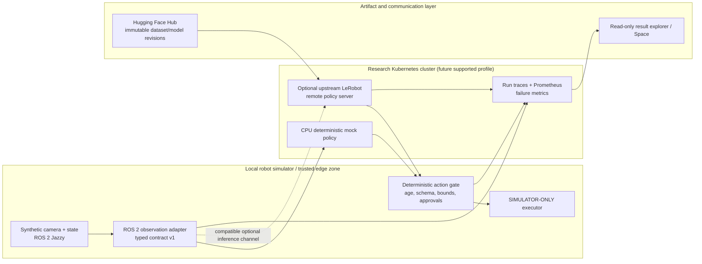

# Vision, reference architecture and product boundaries

> **Design proposal; not implemented.** Read the [current-vs-proposed matrix](README.md) before quoting capabilities.

## Thesis and novelty

The project should be a **reproducible experiment platform** for *ROS 2 + distributed systems + AI policies/agents*. Its defensible value is not a novel Kubernetes distribution, robot foundation model, orchestration product or DDS implementation. It is the combination of:

- A verifiable, small ROS 2 + Kubernetes setup with explicit cross-worker placement and predictable teardown.
- A versioned **observation → policy request → model response → validated simulated action** contract that distinguishes ROS communication from ML policy inference.
- Reproducible environmental impairments, telemetry, model/dataset provenance, and counterexample/failure publication.
- A progression from no-robot/no-GPU student labs to falsifiable systems/robotics research and optional validated hardware later.
- Responsible AI and safe-by-default demos, not marketing claims about autonomous physical robots.

## Jobs to be done

| User | Job | Acceptance signal |
| --- | --- | --- |
| Beginner | Run a meaningful, cheap ROS/K8s exercise and explain the failure | Verified exact commands, log examples, correct conceptual quiz |
| Robotics MSc student | Capture a multimodal, action-labeled episode and validate inference contract | Export/import test with matching feature shapes and timestamp checks |
| PhD systems researcher | Compare compute placements under controlled WAN impairment | Raw trials, common baselines, confidence intervals, publishable negative cases |
| Embodied AI researcher | Reproduce a model/embodiment compatible rollout | Pinned checkpoint + dataset + measured simulator task outcomes |
| LLM researcher | Measure bounded language-to-skill correctness and injection rejection | Declared task set, valid/invalid cases and typed-policy rejections |
| Platform engineer | Study resource limits, recovery, model cache and cluster security | Safe manifests and reproducible failure/recovery metrics |
| Educator | Teach six modules without cloud account or physical robots | Rubrics, no-secret fixtures, independent reproduction evidence |

## Five planes and two distinct networks

1. **Robot/simulator data plane:** ROS 2 nodes publish camera/state and receive *simulator-only*, validated actions; ROS 2 DDS/RMW semantics and QoS apply here.
2. **AI inference plane:** a deterministic mock policy initially; optionally a pinned upstream LeRobot policy server and model processor. LeRobot's documented remote inference uses **Zenoh** and has its **own** endpoint, admission, contract and action-chunk semantics. It must not be mistaken for ROS DDS/Zenoh bridging.
3. **Operations plane:** Kubernetes placement, pod lifecycle, CPU/GPU resources, network policies, bounded restart behavior, observability, secrets and storage.
4. **Artifact and evidence plane:** exact Hugging Face Hub *commit* revisions, dataset episodes, model and dataset cards, image digest, metrics, source SHA and experiment metadata.
5. **Interaction/education plane:** course materials, a read-only web/Space result explorer, and optionally a read-only diagnostic assistant. It is **not** a remotely exposed robot command interface.

### Conceptual architecture

This is a **logical proposal**, not a working deployment diagram. Network paths, security policies, and endpoint syntax require version-specific tests. Mermaid uses simplified arrows; observation/action messages must carry trace and contract identifiers to correlate correct responses.

### Trust boundaries

| Boundary | Trust assumption | Required control | How to test |
| --- | --- | --- | --- |
| External data/bag/Hub files -> Python/ROS | Input untrusted | License review, schema and size limits, content hashes; sandbox third-party code | Malformed frame and unsupported serializer rejected |
| ROS observations -> policy | Sensors/replay can be delayed/spoofed | Timestamp, sequence, FPS, dimensions, ordered units, source ID | Drop/stale/duplicate observation cases |
| Policy output -> simulated executor | Model is **not** an authority | Deterministic action allowlist, bounds, action age, approval and safe-mode gate | Invalid/late/unknown command never dispatched |
| LLM/retrieval -> tools | Text is untrusted, including documents/logs | Read-only diagnostics or allowlisted typed skills, no arbitrary shell/kubectl | Prompt injection and command expansion rejected |
| Kubernetes -> edge | Network/control plane may fail or be hostile | Least privilege, private endpoints, authenticated channels, safe local timeout | Restart, connectivity loss and denial tests |
| HF Hub -> running policy | Revision and license may change | Pinned repo commit, model card, data card, processor and image identity, offline validation | Tampered cache, mutable revision, cache miss |
| Public site / Space -> experiment results | No physical control or secrets | Read-only, reviewed data, no cluster credentials | Anonymous request cannot mutate anything |

### Physical safety boundary: a strict separation

**Cloud or LLM software is not a safety controller.** On real robots, certified safeguards, local motion control, emergency stop and site-specific safety engineering remain separate and mandatory. In this repository the proposed action gate is a **software demonstration in simulation only**, not a substitute for a safety-rated controller. A simulated safe hold need not equal a physically safe stop or torque-off. LeRobot remote inference itself documents robot-specific position-hold support and client fault semantics: do not misrepresent that as safety certification.

## Technology choices and decision records

| Question | Preferred research starting point | Alternatives / gates |
| --- | --- | --- |
| ROS distro | Jazzy on Ubuntu 24.04 for first modern image path | Lyrical/26.04 only as independent validated profile; keep historical Foxy isolated |
| Lightweight cluster | Evaluate kind vs k3d for reproducible two-worker test | Choose via actual Linux resource and DDS tests, not brand |
| ROS networking | Explicit supported DDS discovery; pin RMW/CNI | Zenoh ROS-specific bridge only in a separate #48 comparison |
| Simulation | Tiny scripted/synthetic observation/action fixture first | Modern Gazebo / LeRobot-compatible manipulation simulation only after compatible embodiment is selected |
| ML | Deterministic mock v1; upstream LeRobot policy v2 | SmolVLA is a **candidate** only with compatible state/action/camera/checkpoint/task |
| LLM | Read-only RAG first; typed allowed skills second | Compare small local open-weight model against optional hosted baseline after safety checks |
| Monitoring | Existing Prometheus/Grafana + reproducible ROS-level events | Add ros2_tracing / optional ros2_pulse when verified and correctly interpreted |
| Public demo | GitHub Pages/docs, optional read-only HF Space | No public actuator endpoint or unreviewed dataset |
| CI | Schema, CLI lint, fixtures, no credentials or GPU | Cluster tests only when CI runner can actually run and prove two-worker topology |

Maintain one explicit compatibility decision record per new external dependency: exact version, license, architecture, OS, upstream support, proposed alternatives, why chosen, tests performed, and rollback. **Do not silently merge PR #50**, which contains a related research-strategy proposal; cross-reference rather than overwrite.

## Flagship MVP milestone contracts

**M0: offline proof (not yet implemented)**
- Input fixture: seeded, licensed synthetic camera/state/action/task episode, known FPS, names/units, ROS timestamps and sim frame.
- Contract: exact schema version, observation/episode ID, action semantics and policy revision.
- Output: fake policy produces bounded actions and *clearly marked* fake-policy output; validator rejects mismatches, stale IDs and unauthorized actions.
- Reproducibility: offline manifest + unit tests + raw failure log.
- Exit: second contributor reproduces on CPU machine without tokens.

**M1: cluster proof (gated by existing infrastructure issues)**
- Explicit DDS/RMW/CNI, pods on distinct Kubernetes **worker machines**, machine placement evidence, listener messages counted and verified.
- Independent integration test with timeout and helpful nonzero exit on failure.
- Network isolation, resources and deployment behavior documented; CI green for an image build is insufficient.

**M2: AI proof (optional)**
- A compatible checkpoint with pinned upstream LeRobot version and full model/robot semantics.
- Service and client perform authenticated/versioned contract, observation to predicted chunk and safe simulated output.
- Explicit model incompatibility is a valid outcome and must be documented. Remote handshake != task success.

**M3: research proof**
- Controlled placement/failure conditions, repeated trials, full provenance, observed failure counts, valid confidence intervals and inspectable raw data. Comparison is not interpreted beyond tested hardware, clock assumptions or simulator task.

## Related work and anti-duplication

- [FogROS2](https://github.com/BerkeleyAutomation/FogROS2) already studies ROS/cloud offloading; its prior work on fault tolerance and latency reliability must be cited for new claims.
- [RobotKube](https://github.com/ika-rwth-aachen/robotkube) explores robotics on Kubernetes; [Open-RMF](https://github.com/open-rmf) and [Nav2](https://docs.nav2.org/) are complementary stacks, not features to reimplement.
- [LeRobot](https://huggingface.co/docs/lerobot/) already supports datasets, policies, evaluation and version-specific remote inference; reuse it and its listed ROS bridges.
- [NIST AI RMF](https://www.nist.gov/itl/ai-risk-management-framework) informs risk management; [OWASP LLM prompt injection](https://genai.owasp.org/llmrisk/llm01-prompt-injection/) motivates external text being treated as adversarial input.
- Existing project [#18](https://github.com/MSKazemi/Vagrant-Kubernetes-ROS2-Deployment/issues/18), [#42](https://github.com/MSKazemi/Vagrant-Kubernetes-ROS2-Deployment/issues/42), [#48](https://github.com/MSKazemi/Vagrant-Kubernetes-ROS2-Deployment/issues/48) remain authoritative for their existing workstreams.

