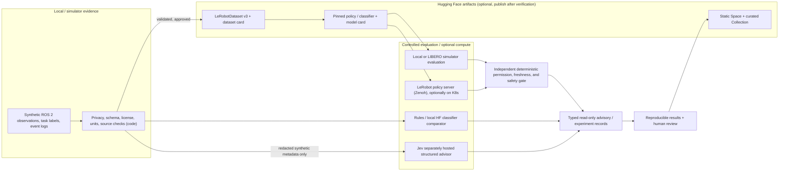

# Reference architecture — Hugging Face + ROS 2 + Kubernetes + Jev

> **A future system design, not an implemented bridge or deployment.** Designed to keep data/research/recommendation separate from action authority.

## Three hard architectural boundaries

1. **Dataset/privacy boundary:** classify every source input by provenance, license and sensitivity. Synthetic-only is the safe default. An HF upload is a separately approved publication decision; never automatically push a real ROS bag, camera recording, location or participant data.
2. **Policy/robot boundary:** the action semantics, observation channels, units, frame order, supported hold-position driver and deadline enforcement must be consistent with the tested LeRobot client/simulator. Jev never generates or authorizes motor commands.
3. **Cloud/network boundary:** HF Hub retrieval is artifact provenance; LeRobot remote policy inference is a **Zenoh** policy transport with documented admission/security and supported hardware contracts. ROS 2 DDS cross-worker behavior requires its own test suite (#14/#15/#16), and Kubernetes GPU readiness is not assumed.

## Proposed versioned contracts

| Contract | Must include | Validator behavior |
| --- | --- | --- |
| `EpisodeManifest` (teaching fixture) | synthetic flag, task/episode ID, FPS/timebase, camera feature map, state/action shape + units, licensing | Unknown/mismatched camera or mixed units => reject |
| `HFArtifactManifest` (planned) | exact Hub repo ID/type and **commit** revision, license, processor/config/checkpoint hash, source commit | Mutable `main`/missing revision => no publishable result |
| `PolicyCompatibility` | robot/simulator, task, modality, action shape/control mode, normalization, expected calibration | Mismatched semantics => reject before inference |
| `JevAdvisory` | bounded question and options, model response ID, criteria hash, probabilities where valid, abstention policy | Timeout/unknown/invalid response => NO_RECOMMENDATION |
| `ExperimentRun` | input family/split, seed, environment, model/processor revision, observed failures, latency, raw outputs and evidence hashes | Unmeasured status => result null; verified claims require independent review |

Reuse existing issues #55/#58/#59/#60/#74 rather than creating incompatible overlapping schemas.

## Placement of Hugging Face functions

- **Training/evaluation:** local offline CPU for toy data/validation, optional GPU for verified compatible VLA/simulation, or separately approved paid HF Jobs. No automated Jobs in GitHub CI.
- **Artifact storage:** Hub repository with Dataset/Model Card and explicit license, only after source rights and model compatibility are checked.
- **Display:** GitHub Pages for crawlable article, Static Space as separately cloned public demonstration, Collection to group verifiable objects.
- **Research advice:** TypeSafe Jev optional hosted comparison; a local HF classifier can act as baseline. Neither may override command permissions or model compatibility.

## Security checklist

- [ ] Public code and demo never contain API tokens, kubeconfigs, real robot addresses, footage or participant PII.
- [ ] Host model revisions immutable and verified; no silent network downloads in offline tests.
- [ ] Strict dataset license / model license checks, explicit expected camera/action dimensions.
- [ ] No active actuator topics, no `kubectl` mutation or privileged API access through website/Space.
- [ ] Remote inference requires supported client, authentication, quotas, expected artifact identity, bounded timeouts and fail-closed simulator state.
- [ ] No false claims of successful multi-node DDS, production safety, actual GPU benchmarks or partnership with Hugging Face/TypeSafe.

Related research documentation: [Capability matrix](CAPABILITIES.md) · [Experiments](EXPERIMENTS.md) · [Root safety](../../SAFETY.md).
